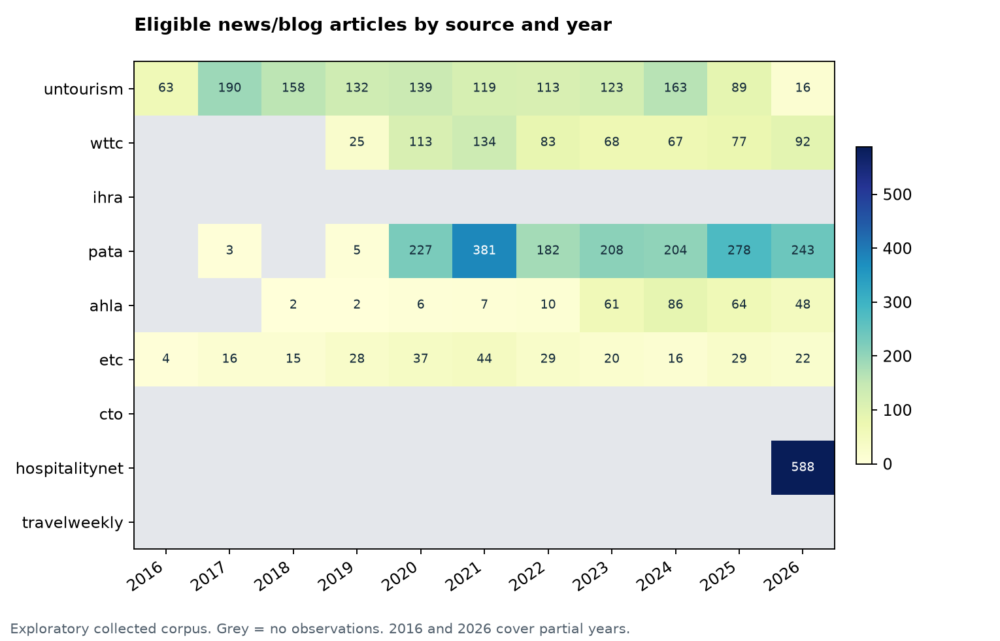
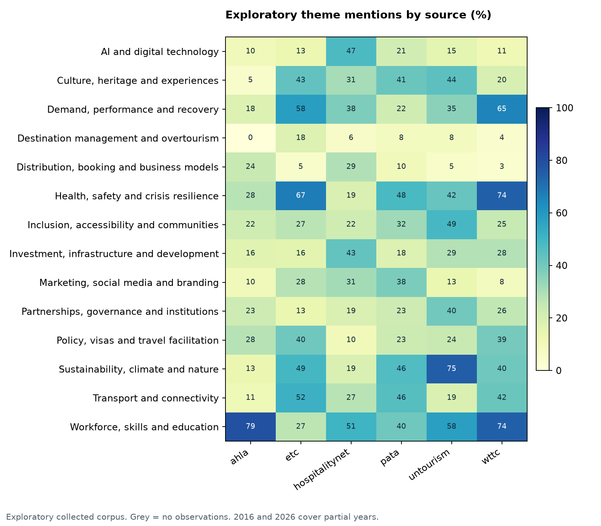
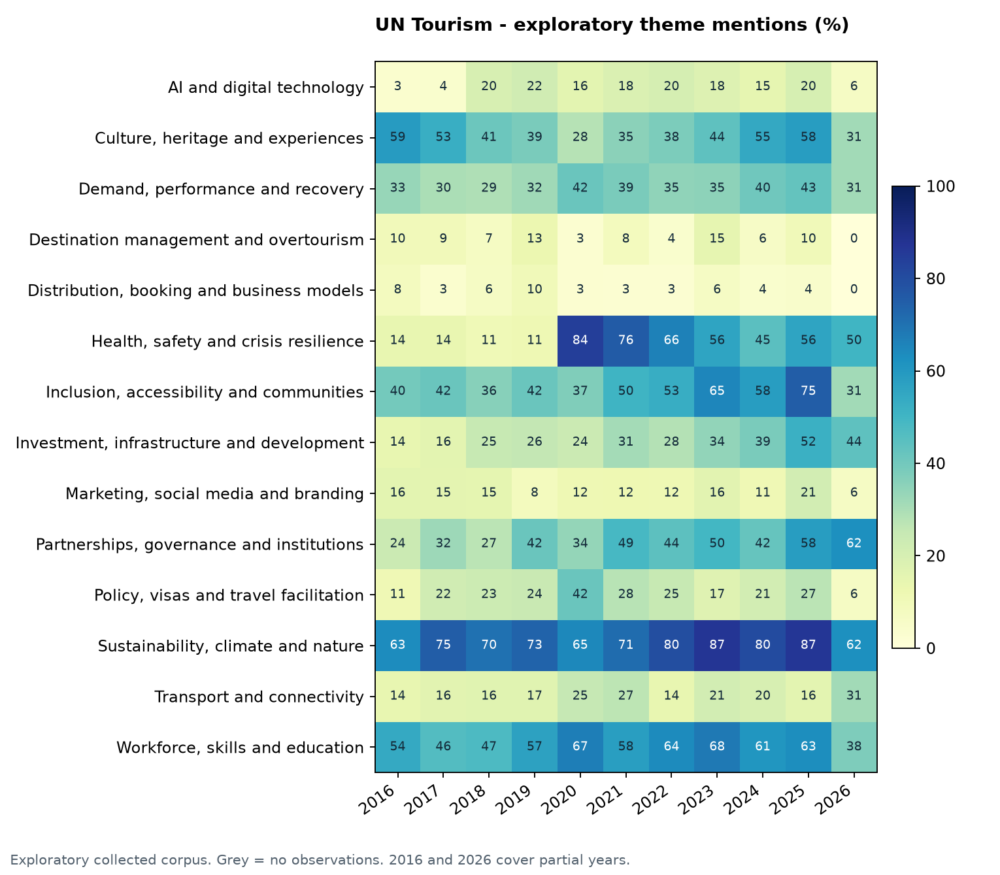
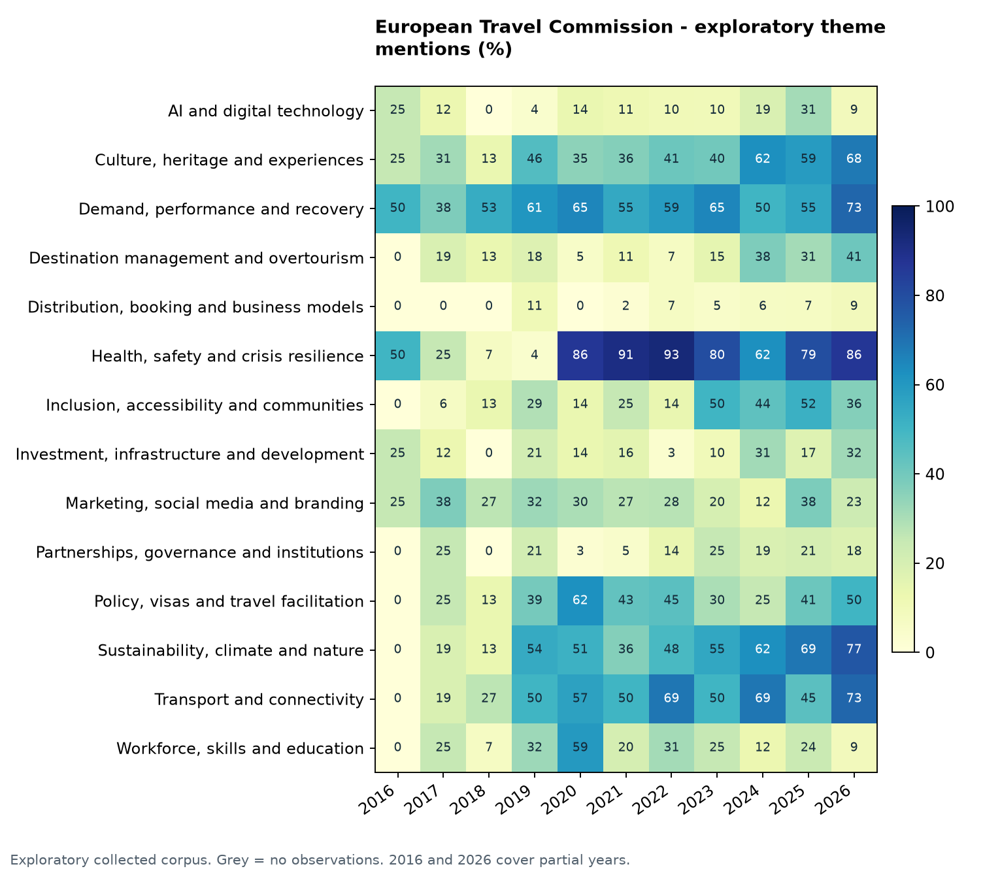
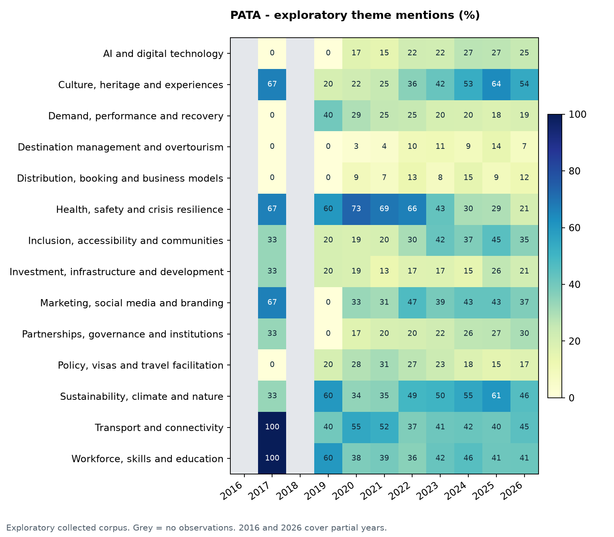
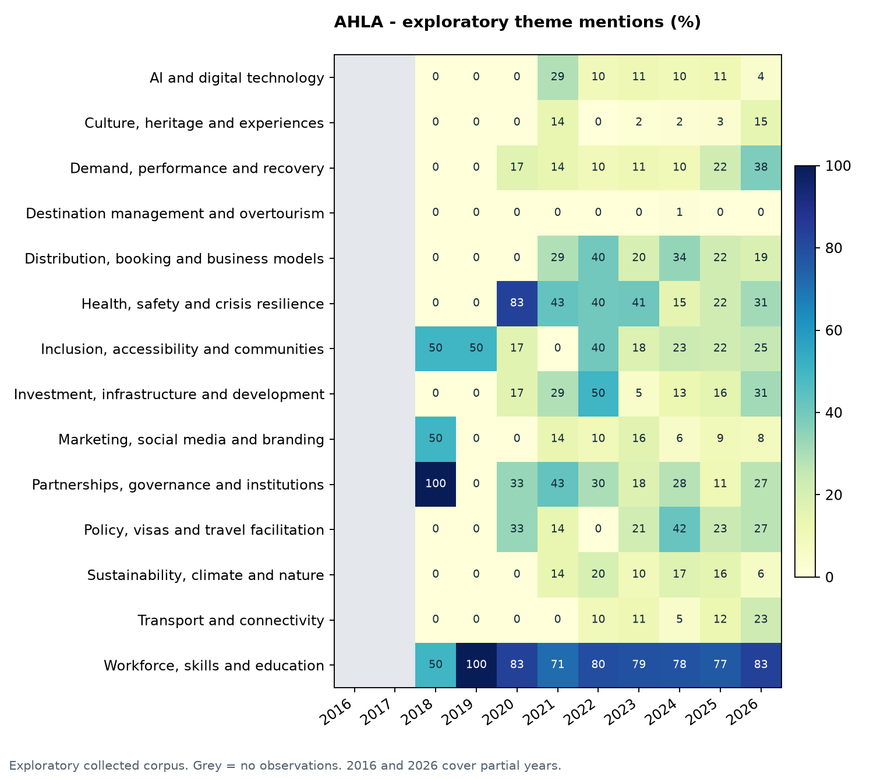
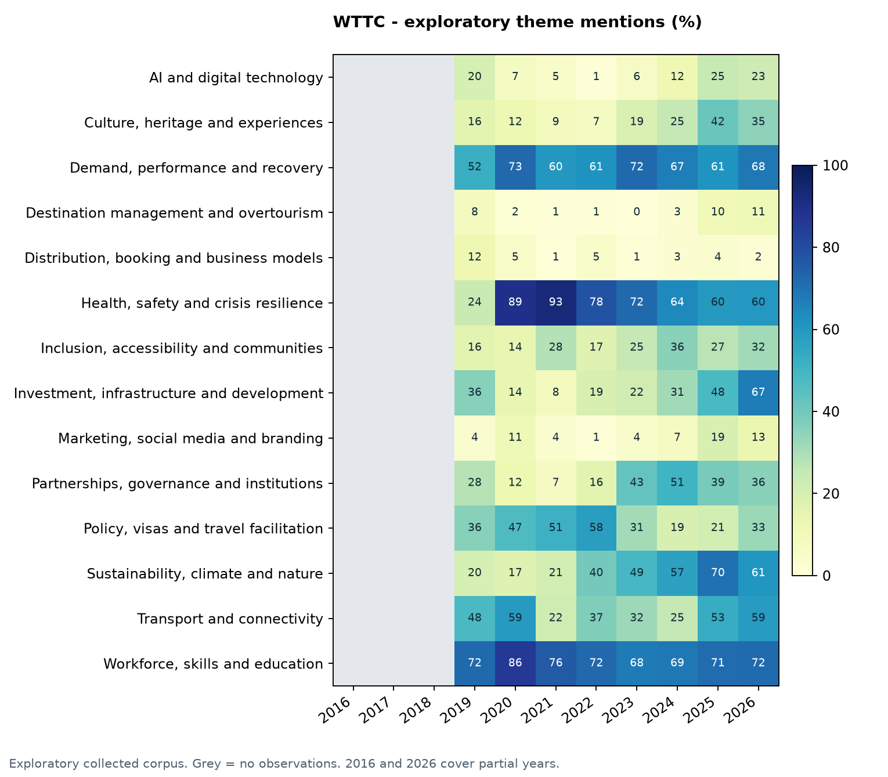
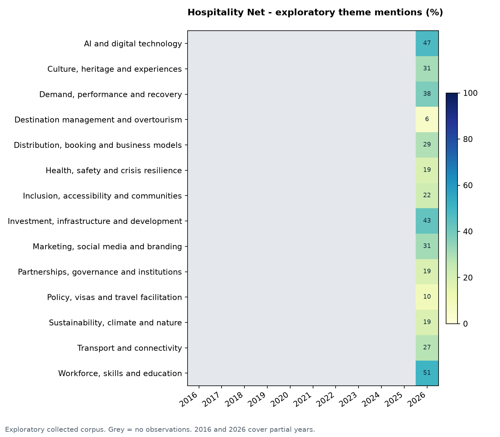

# Tourism and hospitality discourse: preliminary collection and analysis

Snapshot: 2026-10-12T03:57:47.237370+00:00. Requested window: 2016-10-10 through 2026-10-10. English only.

**This is an incomplete, exploratory corpus, not a completed nine-source industry study.** Counts below describe successfully collected eligible records. Unavailable sources are not zero-discussion sources.

Collected 5,659 documents; 5,105 pass date/language/length checks. The primary analysis uses 4,829 news/blog article occurrences after within-source/year deduplication; 257 report summaries/PDF records are kept separately. Current-window articles: 1,124.

## Source coverage

| source | access_status | extracted | core_unique_occurrences | report_records | remaining |
| --- | --- | --- | --- | --- | --- |
| untourism | public_research_review | 1486 | 1305 | 0 | 0 |
| wttc | public_research_review | 780 | 659 | 0 | 0 |
| ihra | public_research_review | 46 | 0 | 0 | 0 |
| pata | public_research_review | 1830 | 1731 | 0 | 0 |
| ahla | public_research_review | 301 | 286 | 0 | 0 |
| etc | public_research_review | 620 | 260 | 257 | 0 |
| cto | public_research_review | 0 | 0 | 0 | 0 |
| hospitalitynet | public_research_review | 596 | 588 | 0 | 0 |
| travelweekly | public_research_review | 0 | 0 | 0 | 0 |

## Ten leading current candidate themes
These are ranked mentions of a predefined 14-concept codebook, not ten independently validated discoveries. One article can match multiple concepts. Equal-source shares prevent the largest collected source from dominating; this does not repair missing sources. Current window: 11 October 2025 through 10 October 2026.

| theme | articles | article_share_pct | equal_source_share_pct | sources_mentioning |
| --- | --- | --- | --- | --- |
| Workforce, skills and education | 561 | 49.9 | 50.3 | 6 |
| Sustainability, climate and nature | 376 | 33.4 | 47.7 | 6 |
| Health, safety and crisis resilience | 299 | 26.6 | 43.5 | 6 |
| Demand, performance and recovery | 399 | 35.5 | 42.2 | 6 |
| Culture, heritage and experiences | 436 | 38.8 | 42.1 | 6 |
| Transport and connectivity | 396 | 35.2 | 40.9 | 6 |
| Investment, infrastructure and development | 423 | 37.6 | 37.3 | 6 |
| Inclusion, accessibility and communities | 316 | 28.1 | 34.2 | 6 |
| Partnerships, governance and institutions | 281 | 25.0 | 31.0 | 6 |
| Policy, visas and travel facilitation | 166 | 14.8 | 23.0 | 6 |

## Themes by year and website
The CSV `themes_by_source_year.csv` includes numerator, denominator, small-sample flags, and partial-year flags. Compare years within sources first. The available sources and archive depth differ. No industry-wide historical trend is claimed.

## Brands and organizations
Dictionary-based name-family matches are exploratory and non-exhaustive. Corporate ownership and formal partnerships are not inferred. Brand-topic associations use a local 350-character context and need semantic review.

| entity | documents | sources |
| --- | --- | --- |
| Hilton | 146 | 6 |
| Marriott | 136 | 5 |
| Sabre | 104 | 4 |
| Expedia | 95 | 5 |
| Hyatt | 86 | 5 |
| IHG | 84 | 6 |
| Dusit | 83 | 2 |
| Accor | 83 | 5 |
| Amadeus | 81 | 5 |
| Tripadvisor | 79 | 4 |
| Booking.com | 76 | 6 |
| ForwardKeys | 76 | 4 |
| Trip.com | 67 | 5 |
| Intrepid | 53 | 4 |
| Airbnb | 53 | 5 |

## Exploratory text clusters
TF-IDF/NMF is a diagnostic, not independent confirmation of the codebook themes. Publisher abbreviations and common byline tokens are removed. Automated descriptive labels, example links and source concentration for every cluster are published in `audit/nmf_cluster_review.csv`. Clusters can still reflect institutions, brands or report formats. Model status: exploratory_unreviewed. A skipped model has no inferred topic results.

| cluster | documents_dominant | top_terms |
| --- | --- | --- |
| 1 | 389 | africa; development; innovation; rural; african; sustainable; investment; forum; women; opportunities; gastronomy; inclusive |
| 2 | 93 | visitor spending; spending; visitor; international visitor; reach; jobs; domestic visitor; impact research; domestic; gdp; economy; economic impact |
| 3 | 278 | lodging; hotel; american; hotel lodging; american hotel; lodging association; washington; association; president ceo; hotels; president; statement |
| 4 | 148 | respondents; sentiment; europe; europeans; travellers; long-haul; trip; trips; survey; summer; planning; months |
| 5 | 478 | covid-; health; uk; safe; measures; restrictions; eu; jobs; testing; recovery; travellers; protocols |
| 6 | 1410 | thailand; asia; bangkok; marketing; pacific; events; event; experience; hospitality; destination; experiences; hotels |
| 7 | 319 | arrivals; europe; tourist arrivals; demand; destinations; growth; international tourist; tourist; markets; compared; levels; recorded |
| 8 | 47 | cultural; sustainable cultural; heritage; awards; ectn; cultural heritage; europa nostra; nostra; europe; europa; cultural routes; winners |
| 9 | 221 | summit; global summit; global; leaders; ceo; president ceo; president; gloria; guevara; growth; future; gloria guevara |
| 10 | 157 | sabre; sabre corporation; technology; airlines; distribution; solutions; corporation; airline; customers; retailing; ndc; marketplace |
| 11 | 386 | sustainability; climate; sustainable; emissions; environmental; action; green; waste; energy; change; initiative; climate action |
| 12 | 73 | gdp; contribution gdp; contribution; jobs; million jobs; million; economy; billion; year; reveals; employment; shows |
| 13 | 516 | organization; sustainable development; development; sustainable; assembly; general assembly; international; rifai; meeting; nations; united nations; member |
| 14 | 107 | saudi; saudi arabia; arabia; scth; executive training; training course; course; training; themis foundation; themis; middle east; middle |
| 15 | 207 | shtm; school; researchers; university; hong kong; kong; hong; school hotel; polyu; hotel management; management; academic |

## Sentiment
`sentiment_unvalidated.csv` and its summary are an optional TextBlob lexicon baseline on theme-related contexts. They have not been validated on this domain and must not be reported as reliable industry attitudes. Mixed positive/negative contexts are retained. Publisher promotional tone and incomplete coverage remain major limitations.

## Automated validation and limitations
The runner automatically audits every saved document and all theme, entity, association and sentiment outputs after analysis. See [the automated audit](audit/AUDIT_REPORT.md) and its run-linked manifest. It checks raw-text/date evidence, topic focus, alternate lead-text probes, TextBlob/VADER disagreement, entity contexts, source weighting and all NMF clusters. This workflow does not depend on a human annotation step. Heuristic agreement is not calibrated accuracy, and two lexical sentiment models cannot establish industry attitudes. The nine-source/year coverage grid records absent observations explicitly. Archived/gated/missing pages can remain unobserved even with an empty queue. Full-text redistribution follows the professor-reported permission and its scope.

## Reproducibility and retention
Source URLs, dates, extraction flags, exclusions, duplicate pairs, codebook, and model settings are exported under `tables/`. Full text remains in the local SQLite database and permitted raw cache, outside the shareable report. No messages were sent and no download forms were submitted. Each publisher retains its content rights.